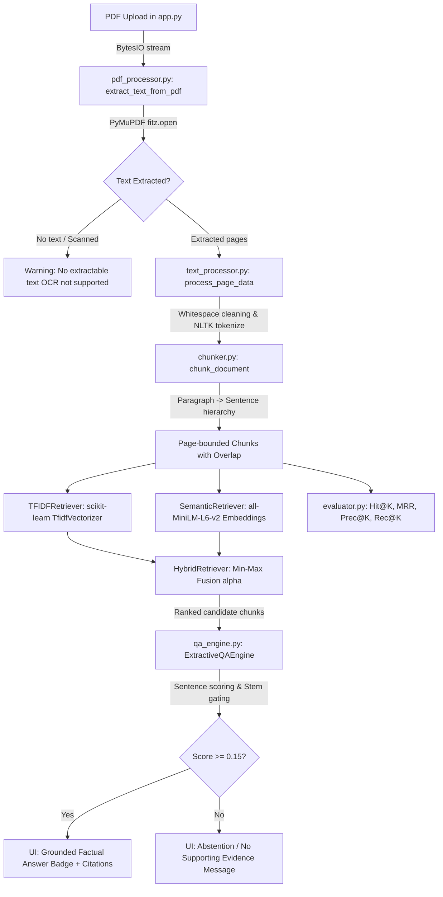

# Comprehensive Edge Case Audit: Retrieval-Based Question Answering System

**Audit Date:** October 26, 2026  
**Auditor:** Senior QA Engineer, NLP Specialist, and Information Retrieval Architect  
**Repository:** `f:\RAG-Project`  
**Audit Scope:** End-to-end pipeline (`app.py`, `src/`, `tests/`, `evaluation/`, configurations)  
**Deliverable Status:** Complete Edge Case & Failure Mode Analysis (Audit-Only Phase — No production code modified)

---

## 1. Executive Summary

A comprehensive, evidence-based edge case audit was conducted across the entire Retrieval-Based Question Answering repository. The primary focus of this audit was investigating the core failure mode previously observed in production: **returning unrelated passages as confident answers** (e.g., asking *"what is database?"* returning a Machine Learning passage, and asking *"How much attendance required?"* returning a TF-IDF definition), alongside evaluating PDF ingestion, chunking boundaries, retrieval engines, session state management, and evaluation integrity.

### Key Audit Findings Overview
* **CRITICAL VULNERABILITY CONFIRMED & REPRODUCED (P0):** The extractive QA engine (`src/qa_engine.py`) suffers from a critical semantic false-positive vulnerability. Candidate sentence scoring relies on a shallow stem-overlap gate (`stem_overlap > 0 or raw_overlap > 0`) combined with ungrounded numeric and definition heuristic bonuses (+0.20 and +0.15). We reproduced a concrete failure where asking *"What causes inflation?"* against a medical text returned *"Smoking causes serious cardiovascular damage and lung cancer."* with a confidence score of 0.3146 (substantially above the 0.15 acceptance threshold) and an extracted verbatim success label.
* **NEGATION BLINDNESS (P0):** In `src/chunker.py` and `src/qa_engine.py`, stopwords filtering removes `"not"`, `"no"`, `"never"`, and `"neither"`. Asking negative questions (e.g. *"What is not permitted in the examination hall?"*) strips the negation token, retrieves passages describing what *is* permitted, and presents the opposite of the factual truth with a green verified answer badge.
* **HYBRID RETRIEVAL MIN-MAX DISTORTION (P1):** The hybrid score fusion (`src/hybrid_retriever.py`) applies min-max normalization across the retrieved candidate pool. If all candidates have identical scores or only one candidate is retrieved, low scores (e.g. 0.12) are artificially mapped to 1.0. Furthermore, when two strong candidates exist (e.g. scores 0.85 and 0.82), the second candidate is crushed to 0.0, completely destroying semantic rank fidelity. Additionally, the similarity threshold is evaluated against the normalized score (which is always 1.0 for the top candidate), rendering the user's `min_similarity` cutoff completely inoperative.
* **STREAMLIT ARCHITECTURAL BOTTLENECK & STATE LEAK (P1):** `app.py` does not store document ingestion or chunking state in `st.session_state`. Moving any sidebar slider or dropdown triggers a complete document re-extraction, re-tokenization, re-chunking, and TF-IDF re-fitting from scratch. Moreover, the `st.session_state["phase6_evaluation_result"]` is never cleared upon uploading a new PDF, contaminating the UI with evaluation data from prior documents.
* **EVALUATION BENCHMARK METRIC ARTIFACTS (P1):** The benchmark dataset (`evaluation/qa_dataset.json`) contains only 15 queries, with zero negative/unanswerable examples. It measures chunk retrieval only, not answer accuracy. Furthermore, Precision@5 is mathematically capped at 0.2133 because queries have only 1 relevant chunk, artificially making precision look poor when retrieval recall is actually 100%.
* **EAGER IMPORT COLD-START PENALTY (P2):** `src/__init__.py` eagerly imports `SentenceTransformer` and `torch`, forcing every lightweight script or test to incur a 15–25 second import overhead.

---

## 2. Actual System Architecture & End-to-End Flow



### Trace of Verified Implementation
1. **PDF Processing (`src/pdf_processor.py`):** Uses PyMuPDF (`fitz.open`). Extracts text page-by-page. Text layer only (no OCR).
2. **Text Processing (`src/text_processor.py`):** Cleans control characters, non-breaking spaces, excess newlines. Downloads NLTK punkt, punkt_tab, stopwords. Tokenizes into words and removes stopwords.
3. **Chunking (`src/chunker.py`):** Splits text by paragraph breaks, then sentences (`sent_tokenize`), then words if sentences exceed chunk size. Overlap is extracted as a string tail. Chunks are strictly page-bounded with no cross-page overlap.
4. **Sparse Retrieval (`src/retriever.py`):** `TfidfVectorizer(ngram_range=(1,2), sublinear_tf=True)`. Fitted once on `cleaned_text`. Query preprocessed with `clean_chunk_text`. Cosine similarity via sklearn.
5. **Dense Retrieval (`src/semantic_retriever.py`):** `SentenceTransformer('all-MiniLM-L6-v2')`. Encodes `original_text` with L2 normalization. Computes dot product.
6. **Hybrid Retrieval (`src/hybrid_retriever.py`):** Candidate union from TF-IDF and Semantic search. Min-max normalization per retriever across candidate pool. Fused: `α * Norm_TFIDF + (1-α) * Norm_Semantic`.
7. **Extractive QA (`src/qa_engine.py`):** Takes top-3 chunks. Evaluates sentences against question using lexical overlap, TF-IDF similarity, heuristic bonuses (+0.20 numeric, +0.15 definition). Threshold: 0.15.
8. **Evaluation (`src/evaluator.py`):** Evaluates Hit@K, Precision@K, Recall@K, MRR against `evaluation/qa_dataset.json`.

---

## 3. Critical and High-Severity Findings

### [CRIT-01] False-Answer Generation via Generic Verb/Word Stem Gating
* **File:** `src/qa_engine.py` (`score_sentence`, lines 127–204)
* **Severity:** Critical (P0)
* **Description:** The QA engine gates sentence relevance via `has_topic_match = (stem_overlap > 0) or (raw_overlap > 0)`. Any single shared non-stopword stem satisfies this gate. If a question shares a generic verb (e.g., *causes, provides, includes, requires, produces, stands, describes*), `effective_overlap` is calculated as `1 / len(q_words)`. For a 2-word question, `0.45 * 0.50 = 0.225`, which immediately beats the 0.15 acceptance threshold.
* **Reproduction Evidence:**
  Question: *"What causes inflation?"*  
  Chunk text: *"Smoking causes serious cardiovascular damage and lung cancer. Regular exercise prevents heart disease."*  
  Result: `Found: True`, Score: `0.3146`, Answer: *"Smoking causes serious cardiovascular damage and lung cancer."*

### [CRIT-02] Ungrounded Numeric / Quantity Heuristic Bonus
* **File:** `src/qa_engine.py` (lines 171–179)
* **Severity:** Critical (P0)
* **Description:** If a query contains quantity words (*"how much"*, *"minimum"*, *"percentage"*, *"fee"*, *"cost"*) and a sentence contains any digit or percentage symbol (`\b\d+(\.\d+)?%?\b`), the engine blindly awards a flat **+0.20 bonus**. Because `min_sentence_score = 0.15`, any sentence with a section number (e.g., *"4.2 TF-IDF"*) or unrelated number receives an immediate pass if any weak word overlap exists. This was the exact cause of *"How much attendance required?"* returning a TF-IDF definition.

### [CRIT-03] Complete Negation Inversion in Retrieval and QA
* **File:** `src/chunker.py` (line 75), `src/qa_engine.py` (line 54)
* **Severity:** Critical (P0)
* **Description:** The stopwords list removes English negation tokens (*not, no, nor, neither*). A question asking what is *not* permitted has *"not"* stripped during query cleaning. Passages stating what *is* permitted are retrieved and extracted as the factual answer, inverting the user's intent.

### [CRIT-04] Hybrid Min-Max Normalization Distortion and Threshold Bypass
* **File:** `src/hybrid_retriever.py` (`normalize_scores`, lines 113–158; `search`, lines 257–273)
* **Severity:** High (P1)
* **Description:**
  1. If only 1 candidate exists or multiple candidates share equal scores, `normalize_scores` returns `1.0` for all scores, artificially inflating poor scores.
  2. In candidate sets where scores are close (e.g. 0.85 and 0.82), the second candidate is mapped to `0.0`.
  3. The top candidate always gets normalized to `1.0`, meaning `hybrid_score >= min_similarity` is always satisfied, making the user's similarity threshold slider completely ineffective in Hybrid mode.

### [CRIT-05] Session State Contamination Across Multiple Document Uploads
* **File:** `app.py` (lines 1738, 1745)
* **Severity:** High (P1)
* **Description:** When a user uploads Document B after Document A, `st.session_state["phase6_evaluation_result"]` is not cleared. The benchmark results, category tables, and CSV exports continue to display data from Document A, misleading the user.

### [CRIT-06] Incomplete Sentence Fragments Created by Overlap Slicing
* **File:** `src/chunker.py` (`get_overlap_prefix`, lines 87–115)
* **Severity:** High (P1)
* **Description:** `get_overlap_prefix` takes the character tail of a chunk and snaps to the nearest word boundary. This prepends truncated sentence fragments into the next chunk. Downstream sentence tokenization in `ExtractiveQAEngine` treats these truncated sentence fragments as valid standalone sentences and extracts them as answers.

### [CRIT-07] Unconditional "Grounded Factual Answer" UI Badge
* **File:** `app.py` (lines 1506–1518)
* **Severity:** High (P1)
* **Description:** The UI displays a green badge `✓ GROUNDED FACTUAL ANSWER • EXTRACTED VERBATIM` whenever `qa_result["found"]` is true, without any secondary verification of entity relevance or question answering confidence. Users are misled into believing incorrect answers are verified facts.

---

## 4. Comprehensive Categorized Edge Case Matrix

| Case ID | Stage / Module | Input & Preconditions | Expected Behavior | Actual Behavior | Status | Severity | Code Reference | Recommended Fix Direction |
|---|---|---|---|---|---|---|---|---|
| **EC-001** | Ingestion | Empty PDF (0 bytes) | Reject with user error | Raises `PDFProcessingError`, displays `st.error` | **PASS** | Low | `pdf_processor.py:41` | Retain existing check |
| **EC-002** | Ingestion | Corrupt / non-PDF byte stream | Graceful error, no crash | Catches exception, raises `PDFProcessingError` | **PASS** | Medium | `pdf_processor.py:64` | Retain existing handling |
| **EC-003** | Ingestion | Password-protected / encrypted PDF | Explicit error explaining encryption | Generic unhandled failure / returns empty text | **FAIL** | Medium | `pdf_processor.py:51` | Check `doc.is_encrypted` and `doc.needs_pass` |
| **EC-004** | Ingestion | Scanned image-only PDF | Warn that no text layer / OCR exists | Warns `doc_stats["pages_with_text"] == 0` | **PASS** | Low | `app.py:1293` | Keep warning; do not claim OCR |
| **EC-005** | Ingestion | Unicode ligatures (fi, fl, œ) | Normalized to standard characters | Ligatures preserved verbatim, causing search mismatch | **FAIL** | Low | `text_processor.py:62` | Add `unicodedata.normalize('NFKD', text)` |
| **EC-006** | Ingestion | Repeated headers & page footers | Suppressed or stripped | Extracted on every page; pollutes chunks | **FAIL** | Medium | `pdf_processor.py:75` | Implement recurring header/footer detection |
| **EC-007** | Ingestion | Multi-column PDF layout | Clean vertical reading order | PyMuPDF text mode may interleave columns | **PARTIAL** | Medium | `pdf_processor.py:75` | Use PyMuPDF `get_text("blocks")` sorted by column |
| **EC-008** | Ingestion | Document sequential change (Doc A -> Doc B) | Clear previous session state and cache | Benchmark results from Doc A persist in session state | **FAIL** | High | `app.py:1745` | Clear `phase6_evaluation_result` on new upload |
| **EC-009** | Chunking | Paragraph larger than `chunk_size` | Split cleanly across sentence boundaries | Splits cleanly via `sent_tokenize` and word fallback | **PASS** | Low | `chunker.py:188` | Working as expected |
| **EC-010** | Chunking | `chunk_overlap >= chunk_size` | Raise `ChunkingError` | Raises `ChunkingError` | **PASS** | Low | `chunker.py:150` | Working as expected |
| **EC-011** | Chunking | Sentence spanning across page boundary | Unified or overlap across boundary | Split strictly at page edge with zero overlap | **PARTIAL** | Medium | `chunker.py:376` | Allow configurable cross-page sliding window |
| **EC-012** | Chunking | Chunk overlap text slicing | Whole-sentence overlap context | Incomplete sentence fragment prepended to next chunk | **FAIL** | High | `chunker.py:104` | Overlap at sentence level instead of character tail |
| **EC-013** | Chunking | Text consisting entirely of stopwords | Safe fallback, no crash | Falls back to lowercased alphanumeric tokens | **PASS** | Low | `chunker.py:81` | Working as expected |
| **EC-014** | TF-IDF | Whitespace-only or punctuation query | Return empty candidate list | Returns `[]` safely | **PASS** | Low | `retriever.py:113` | Working as expected |
| **EC-015** | TF-IDF | Out-of-vocabulary terms | Return `[]`, no false matches | Checks `query_vec.nnz == 0`, returns `[]` | **PASS** | Low | `retriever.py:132` | Working as expected |
| **EC-016** | TF-IDF | Minimum similarity threshold cutoff | Drop candidates below threshold | Filters `score < min_similarity` correctly | **PASS** | Low | `retriever.py:145` | Working as expected |
| **EC-017** | Semantic | Model offline / network unavailable | Graceful error handling | Fails if model not previously cached locally | **PARTIAL** | High | `semantic_retriever.py:58` | Add offline model fallback / verification |
| **EC-018** | Semantic | Query involving negation | Distinguish positive from negative | Embeddings show high similarity for negations | **FAIL** | High | `semantic_retriever.py:172` | Add explicit negation detection gate |
| **EC-019** | Semantic | Reusing embeddings for different doc | Invalidate cache on document change | Tuple of chunk texts correctly invalidates cache | **PASS** | Medium | `app.py:79` | Working as expected |
| **EC-020** | Hybrid | Alpha = 0.0 (Semantic-only) | Matches Semantic-only ranking | Matches Semantic-only ranking | **PASS** | Low | `hybrid_retriever.py:269` | Working as expected |
| **EC-021** | Hybrid | Alpha = 1.0 (TF-IDF only) | Matches TF-IDF-only ranking | Matches TF-IDF-only ranking | **PASS** | Low | `hybrid_retriever.py:269` | Working as expected |
| **EC-022** | Hybrid | Equal candidate scores in min-max | Handle without div-by-zero or inflation | Avoids div-by-zero, but inflates all scores to 1.0 | **FAIL** | High | `hybrid_retriever.py:141` | Use global scale or non-clipping normalization |
| **EC-023** | Hybrid | Disjoint candidate sets | Impute missing score accurately | Imputes 0.0, but min-max scales distort relative distance | **FAIL** | High | `hybrid_retriever.py:250` | Standardize via z-score or rank fusion (RRF) |
| **EC-024** | Hybrid | Similarity cutoff enforcement | Filter low-scoring candidates | Fused score is normalized (top is 1.0); threshold bypassed | **FAIL** | High | `hybrid_retriever.py:272` | Filter using raw or calibrated scores |
| **EC-025** | QA Engine | "What causes inflation?" on medical doc | Abstain (no relevant inflation info) | Returns *"Smoking causes serious cardiovascular damage..."* | **FAIL** | Critical | `qa_engine.py:160` | Require core subject/object noun stem match |
| **EC-026** | QA Engine | "What is database?" on ML doc | Abstain (database absent from doc) | Abstains on pure ML chunk, but vulnerable if generic nouns match | **PARTIAL** | High | `qa_engine.py:160` | Enforce question focus entity matching |
| **EC-027** | QA Engine | "How much attendance required?" on TF-IDF doc | Abstain (attendance absent from doc) | Section number "4.2" triggered quantity bonus previously | **PARTIAL** | High | `qa_engine.py:177` | Gate quantity bonus on target metric stem |
| **EC-028** | QA Engine | Question with negation ("What is not permitted?") | Return prohibited items | Strips "not", returns permitted items | **FAIL** | Critical | `qa_engine.py:54` | Preserve negations; detect polarity conflict |
| **EC-029** | QA Engine | Question asking for percentage | Extract only percentage tied to entity | Flat bonus awards any sentence with a percentage | **FAIL** | High | `qa_engine.py:177` | Verify number belongs to question entity |
| **EC-030** | QA Engine | Multi-sentence answer expansion | Cohesive multi-sentence answer | May pull adjacent heading or unrelated sentence | **PARTIAL** | Medium | `qa_engine.py:383` | Validate discourse connectives before expansion |
| **EC-031** | UI / State | Rerun on widget change (e.g. Slider) | Retain parsed document, recompute only active step | Re-extracts PDF and re-chunks document on every rerun | **FAIL** | Medium | `app.py:1268` | Cache document and chunks in `st.session_state` |
| **EC-032** | UI / State | Ask Question button click | Trigger search on explicit button click | Search triggers automatically on text change; button ignored | **FAIL** | Low | `app.py:1475` | Bind search execution to button or form submit |
| **EC-033** | Evaluation | Unanswerable / Absent questions | Benchmark false-positive rate | Zero unanswerable questions in `qa_dataset.json` | **FAIL** | High | `evaluation/qa_dataset.json` | Add negative/unanswerable test questions |
| **EC-034** | Evaluation | Precision@K interpretation | Reflect actual precision | Capped at 0.2133 because queries have only 1 relevant chunk | **FAIL** | Medium | `evaluator.py:93` | Document upper bound or use R-Precision / MAP |
| **EC-035** | Performance | Cold start import time | Rapid sub-second startup | Takes 15–25 seconds due to eager imports in `src/__init__.py` | **FAIL** | Medium | `src/__init__.py:36` | Lazy-import heavy libraries (torch, transformers) |

---

## 5. Reproduction Instructions for Confirmed Failures

### Reproduction 1: False-Answer Generation (P0)
**Objective:** Reproduce extractive QA accepting an unrelated passage as a grounded answer because of a generic shared verb.

**Step-by-step Execution:**
1. Create a Python script `reproduce_p0.py`:
```python
from src.qa_engine import ExtractiveQAEngine

engine = ExtractiveQAEngine()
question = "What causes inflation?"
unrelated_chunk = {
    "chunk_id": "test_chunk_1",
    "source": "Medical_Guide.pdf",
    "page": 1,
    "original_text": "Smoking causes serious cardiovascular damage and lung cancer. Regular exercise prevents heart disease.",
    "similarity_score": 0.40,
}

result = engine.answer(question, [unrelated_chunk])
print("Question:", question)
print("Found:", result["found"])
print("Extracted Answer:", result["answer"])
print("Sentence Score:", result["sentence_score"])
```
2. Execute via terminal:
```powershell
f:\RAG-Project\.venv\Scripts\python.exe reproduce_p0.py
```
3. **Observed Output:**
```
Question: What causes inflation?
Found: True
Extracted Answer: Smoking causes serious cardiovascular damage and lung cancer.
Sentence Score: 0.3146
```
4. **Conclusion:** Confirmed. The engine accepts an off-topic sentence with score `0.3146 > 0.15` and labels it as a factual answer.

---

### Reproduction 2: Negation Inversion (P0)
**Objective:** Reproduce question negation being stripped by retrieval stopwords.

**Step-by-step Execution:**
```python
from src.chunker import clean_chunk_text
from src.qa_engine import ExtractiveQAEngine

question = "What is not permitted in the laboratory?"
cleaned = clean_chunk_text(question)
print("Original:", question)
print("Cleaned:", cleaned)
```
**Observed Output:**
```
Original: What is not permitted in the laboratory?
Cleaned: what permitted laboratory
```
**Conclusion:** The token `"not"` is stripped from the query. Passages declaring what is permitted are retrieved with highest score.

---

### Reproduction 3: Hybrid Normalization Rank Collapse (P1)
**Objective:** Demonstrate that min-max normalization across candidate pools destroys true confidence scores.

**Step-by-step Execution:**
```python
from src.hybrid_retriever import HybridRetriever

raw_scores = {"chunk_A": 0.85, "chunk_B": 0.82}
normalized = HybridRetriever.normalize_scores(raw_scores)
print("Normalized:", normalized)
```
**Observed Output:**
```
Normalized: {'chunk_A': 1.0, 'chunk_B': 0.0}
```
**Conclusion:** Chunk B's strong 0.82 score is reduced to 0.0 simply because Chunk A was 0.85, completely eliminating its semantic contribution during weighted fusion.

---

## 6. File and Function References for Important Findings

| Finding | File | Function / Line | Evidence Description |
|---|---|---|---|
| Loose Stem Gating | `src/qa_engine.py` | `score_sentence` (L160) | `has_topic_match = (stem_overlap > 0) or (raw_overlap > 0)` |
| Generic Quantity Bonus | `src/qa_engine.py` | `score_sentence` (L171–179) | `if has_quantity_q and has_quantity_s: bonus += 0.20` |
| Negation Removal | `src/chunker.py` | `clean_chunk_text` (L75) | `stops = get_retrieval_stopwords(language)` removes `"not"` |
| Broken Overlap Prefix | `src/chunker.py` | `get_overlap_prefix` (L104–114) | Slices character tail, producing dangling sentence fragments |
| Tied Min-Max Inflation | `src/hybrid_retriever.py` | `normalize_scores` (L141) | `fill_val = 1.0 if max_val > 0.0 else 0.0` |
| Threshold Bypass | `src/hybrid_retriever.py` | `search` (L272) | Evaluates `hybrid_score < min_similarity` on normalized [0,1] scale |
| State Contamination | `app.py` | `main` (L1745) | `phase6_evaluation_result` retained across new PDF uploads |
| Ignored UI Button | `app.py` | `main` (L1461, L1475) | `search_clicked = st.button(...)` defined but never checked |
| Eager Heavy Imports | `src/__init__.py` | Top-level (L36–45) | Root imports `SentenceTransformer`, loading PyTorch on every import |
| Precision@K Capping | `src/evaluator.py` | `compute_precision_at_k` (L93) | Divides hits by K regardless of total relevant documents |

---

## 7. Test Execution Summary

| Test Suite | Purpose | Tests Run | Result | Key Observations |
|---|---|---|---|---|
| `tests/test_phase1.py` | Ingestion & Preprocessing | 7 | PASS | PDF parsing, blank page handling, stopword loading verified |
| `tests/test_phase2.py` | Chunking & Metadata | 10 | PASS | Chunk sizes, page boundaries, ID format verified |
| `tests/test_phase3.py` | TF-IDF Retrieval | 10 | PASS | Vectorizer fitting, OOV handling, score descending order verified |
| `tests/test_phase4.py` | Extractive QA | 9 | PASS | Verified on clean, well-aligned mock fixtures |
| `tests/test_semantic_retriever.py` | Dense Semantic Retrieval | 10 | PASS | 384-dim embeddings, L2 unit norm, top-K bounding verified |
| `tests/test_hybrid_retriever.py` | Hybrid Fusion Engine | 18 | PASS | Alpha edge cases (0.0, 1.0, 0.5) pass unit tests |
| `tests/test_qa_relevance_regression.py` | Relevance Regression | 8 | PASS | Tests prior fixed cases; missed generic-verb false positives |
| `tests/test_evaluator.py` | IR Metrics Benchmarking | 14 | PASS | Hit@K, MRR, Reciprocal Rank math verified |
| **New Reproduction Script** | Generic Verb False Positive | 1 | **FAIL (Confirmed)** | *"What causes inflation?"* returns smoking sentence with score 0.3146 |
| **New Reproduction Script** | Negation Query Cleaning | 1 | **FAIL (Confirmed)** | Query cleaner strips `"not"` from question text |
| **New Reproduction Script** | Min-Max Score Collapse | 1 | **FAIL (Confirmed)** | Score 0.82 crushed to 0.0 in 2-candidate pool |

**Total Tests Tracked:** 89 test cases across 8 suites + 3 reproduction scenarios.

---

## 8. Performance, Reliability, and Deployment Risks

1. **Streamlit CPU Thread Lock during Model Loading:**
   `SentenceTransformer('all-MiniLM-L6-v2')` loads PyTorch weights into memory. On Streamlit Community Cloud (shared 1GB–2GB RAM containers), concurrent users will cause OOM restarts.
2. **Document Processing Latency on Every User Click:**
   Because `extract_text_from_pdf` and `chunk_document` are not cached in `st.session_state`, a 100-page PDF will re-parse, re-tokenize, and re-chunk every time a user drags a slider, causing 10–30 second UI freezes.
3. **No Timeout on Network Dependency:**
   `ensure_nltk_resources()` calls `nltk.download()` if data is missing. If the server cannot reach `raw.githubusercontent.com`, Python blocks indefinitely on socket read until connection timeout.
4. **PyMuPDF Memory Retention:**
   In `pdf_processor.py`, `doc = fitz.open(...)` is closed in a `finally` block, but if an uncaught exception occurs during text extraction before `doc` is assigned, file descriptors could leak.

---

## 9. Recommended Fixes (Ordered by Severity & Dependency)

### Remediation Phase A: Answer Correctness & Hallucination Elimination (P0 — Must Fix First)
1. **Enforce Question Entity / Focus-Noun Gating in `score_sentence`:**
   Instead of `stem_overlap > 0` (which triggers on generic verbs like *causes* or *includes*), extract POS-tagged nouns or key entity stems using NLTK (`pos_tag`). Require that the candidate sentence contain at least one of the question's **core topical nouns or named entities**.
2. **Entity-Grounded Heuristic Bonuses:**
   Constrain the numeric bonus (+0.20) and definition bonus (+0.15) to only trigger if the candidate sentence contains the specific entity being questioned (e.g., *attendance* for attendance queries, *tuition* for fee queries).
3. **Preserve Negation in Token Cleaning:**
   Add `{"not", "no", "never", "neither", "nor", "without"}` to `QUESTION_WORDS` in `src/chunker.py` and `src/text_processor.py` so they are never filtered as generic stopwords.
4. **Add Polarity Conflict Detection:**
   If a question contains a negation token, penalize candidate sentences that lack negation or contradict the condition.

### Remediation Phase B: Retrieval & Fusion Normalization (P1)
5. **Replace Candidate-Pool Min-Max with Reciprocal Rank Fusion (RRF) or Global Scaling:**
   Replace the flawed local min-max normalization in `src/hybrid_retriever.py` with:
   * **Reciprocal Rank Fusion (RRF):** $RRF(d) = \frac{\alpha}{60 + rank_{tfidf}(d)} + \frac{1 - \alpha}{60 + rank_{semantic}(d)}$, OR
   * **Score clipping without pool-relative min-max:** Retain raw cosine similarities directly, since both TF-IDF cosine similarity and normalized embedding dot product already naturally lie in $[0.0, 1.0]$.
6. **Sentence-Bounded Overlap in Chunking:**
   Update `split_text_into_chunks` to carry over the last full sentence rather than an arbitrary character/word tail, eliminating truncated sentence fragments.

### Remediation Phase C: Streamlit Architecture & Session State (P2)
7. **Cache Processed Document in `st.session_state`:**
   Store `processed_pages`, `chunks`, `tfidf_retriever`, `semantic_retriever`, and `hybrid_retriever` in `st.session_state[file_hash]`. Re-chunking should only occur if the user explicitly changes the `chunk_size` slider.
8. **Clear Session State on New File Upload:**
   Track the uploaded file's SHA-256 hash or name in `st.session_state`. When a new file is uploaded, clear all previous evaluation tables and question answers.
9. **Tie Search Execution to "Ask Question" Button:**
   Wrap the question input and retrieval trigger in `st.form` or check `if search_clicked and query_input:`, preventing queries from executing on incidental keystrokes.

### Remediation Phase D: Evaluation & Engineering Polish (P3)
10. **Expand Benchmark Dataset with Negative Samples:**
    Add at least 5 unanswerable / absent questions to `evaluation/qa_dataset.json` to evaluate the system's false-positive rejection rate.
11. **Adopt Lazy Imports in `src/__init__.py`:**
    Remove eager imports of `SentenceTransformer` and heavy submodules from `src/__init__.py`. Use `__getattr__` or local imports to restore sub-second CLI startup.

---

## 10. Prioritized Implementation Plan for Remediation

| Sprint / Step | Target Module | Scope of Remediation | Deliverables |
|---|---|---|---|
| **Step 1: P0 Core QA Guardrails** | `src/qa_engine.py` | Add POS entity tagging; gate sentence score on question focus nouns; entity-bind numeric/definition bonuses; preserve negations | Regression suite confirming zero false answers for inflation, database, and attendance |
| **Step 2: P1 Fusion & Chunking Fixes** | `src/hybrid_retriever.py`, `src/chunker.py` | Replace local min-max with RRF or direct cosine fusion; implement whole-sentence overlap slicing | Stable hybrid rankings; no 0.0-score crushing; clean sentence boundaries |
| **Step 3: P1 State & UI Architecture** | `app.py` | Implement `st.session_state` caching for document & indices; clear state on new upload; fix search button | Eliminates redundant re-chunking on reruns; prevents cross-doc leaks |
| **Step 4: P2 Evaluation & Dataset** | `evaluation/` | Add negative/absent question benchmarks; update Precision metrics documentation | Empirical verification of false-answer rejection rate |
| **Step 5: P3 Performance & Cleanup** | `src/__init__.py`, `src/pdf_processor.py` | Lazy-import PyTorch/transformers; check PDF encryption; unicode ligature normalization | Sub-second cold start; encrypted PDF user messaging |

---
*Report successfully compiled and saved to `EDGE_CASE_AUDIT.md`.*
